# CodeSage AI — Intelligent GitHub Code Reviewer

CodeSage AI connects to your GitHub account, reviews repositories and pull requests with **static analyzers plus a large language model**, and explains every finding: what is wrong, where it is, why it matters, how severe it is and how to fix it, with before/after code.

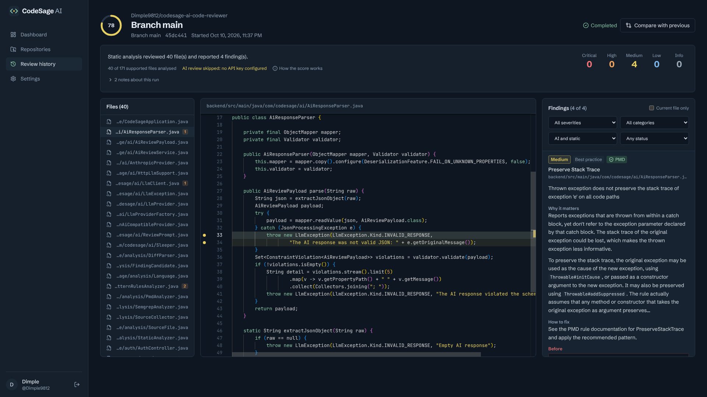

> Screenshots come from a real local run in which CodeSage reviewed this repository and other public repositories through the GitHub API. The run had no AI provider key, so the reviews show static-analysis findings plus the "AI review skipped" notice. See [Screenshots](#screenshots) for how they were taken.

---

## Contents

- [Problem statement](#problem-statement)
- [Key features](#key-features)
- [Tech stack](#tech-stack)
- [Architecture](#architecture)
- [Review workflow](#review-workflow)
- [Database design](#database-design)
- [Folder structure](#folder-structure)
- [Getting started](#getting-started)
- [Configuration](#configuration)
- [API](#api)
- [Testing](#testing)
- [Security](#security)
- [Screenshots](#screenshots)
- [Known limitations](#known-limitations)
- [Deployment](#deployment)
- [Future enhancements](#future-enhancements)
- [Contributing](#contributing) · [License](#license)

## Problem statement

Human review time is scarce. Linters catch style issues but miss intent, and LLM-only reviewers invent problems and are hard to trust. CodeSage combines the two:

- **Deterministic static analysis** (PMD for Java, plus CodeSage's own security and configuration rules, with optional Semgrep) produces findings you can verify.
- **An LLM review** looks for logic, reliability and design defects that rules cannot express. Its output must pass a strict schema, every finding is anchored to a real file and line, and each one is labelled **AI · unverified**.
- **Everything is explicit.** Nothing is pushed, approved or merged. PR comments are posted only after you confirm.

## Key features

| Area | What it does |
| --- | --- |
| GitHub sign-in | OAuth App login through Spring Security. Validates OAuth `state`, encrypts the token at rest (AES-256-GCM) and never sends it to the browser. |
| Repositories | Lists every repository your account can access (public and private, depending on scopes). Search and filter them, browse branches, recent commits and open PRs. |
| Repository review | Reviews the latest commit of any branch. Generated, vendored, binary and oversized files are excluded automatically. |
| Pull request review | Reviews only the added/modified lines (diff-aware) and maps findings to changed lines. Selected findings can be published as a COMMENT review after confirmation. |
| Webhooks | Handles `pull_request` opened / synchronize / reopened events with HMAC-SHA256 signature verification, duplicate-delivery protection and asynchronous processing. |
| AI engine | Anthropic Claude (default), OpenAI, Google Gemini or any OpenAI-compatible endpoint. Bounded context, line-numbered prompts, schema validation, retries with backoff, timeout and rate-limit handling. |
| Static analysis | PMD 7 runs in-process. The CodeSage rules cover secrets, SQL/command injection, XSS sinks, weak crypto, disabled TLS, unsafe deserialisation, C buffer functions, and invalid JSON/YAML. Semgrep is optional. |
| Workspace | Three-pane view: file explorer, Monaco source viewer with finding markers, and a findings panel with filters. Each finding shows an explanation, impact, fix and before/after code. |
| History & comparison | Filter reviews by repository, date, status, severity and branch. Compare runs to see **new**, **fixed** and **recurring** findings. |
| Dashboard | Repositories, reviews, open critical/high findings, resolved vs open, 30-day activity and the most frequent categories. All figures come from persisted data. |
| Settings | AI provider and model, an optional personal API key (stored encrypted and shown only as `••••abcd`), analyzers, languages, minimum severity, file limits, and account disconnect or delete. |

## Tech stack

**Frontend:** React 19, TypeScript 5.9, Vite 7, Tailwind CSS 4, React Router 7, TanStack Query 5, Monaco Editor (bundled locally), Recharts 3, Lucide icons, Axios, Sonner toasts, Vitest and Testing Library.

**Backend:** Java 21, Spring Boot 3.5 (Web, Security, OAuth2 Client, Data JPA, Validation, Actuator, Cache, Data Redis), Flyway, PostgreSQL 16, PMD 7, springdoc-openapi, JUnit 5, Mockito, MockWebServer, Testcontainers, embedded PostgreSQL (zonky).

**Infrastructure:** Docker multi-stage images, Docker Compose (PostgreSQL, Redis, backend, nginx frontend), GitHub Actions CI and Dependabot.

## Architecture

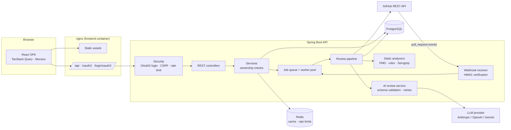

The backend is organised by feature (`auth`, `security`, `github`, `repository`, `pullrequest`, `review`, `analysis`, `ai`, `findings`, `webhook`, `dashboard`, `settings`). Controllers handle HTTP only, services hold the business logic and ownership checks, and external systems are reached only through `GitHubClient` and the `LlmProvider` implementations. More detail: [docs/architecture.md](docs/architecture.md).

## Review workflow

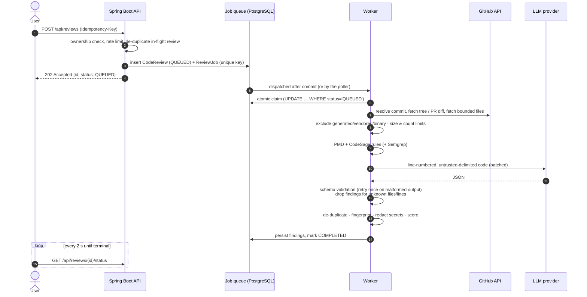

**Statuses:** `QUEUED → RUNNING → COMPLETED | FAILED | CANCELLED`. Transient GitHub failures (rate limits, 5xx) are retried with exponential backoff, up to `REVIEW_JOB_MAX_ATTEMPTS` attempts. If the AI step fails, the review still completes with its static findings, and the reason is recorded as `aiStatus` (`FAILED`, `PARTIAL`, `SKIPPED_NOT_CONFIGURED`, …).

**Score.** The score is a deterministic heuristic, not a validated quality metric:

```
penalty = Σ weight(severity) × confidence        weights: CRITICAL 25, HIGH 10, MEDIUM 4, LOW 1.5, INFO 0
score   = round(100 × 50 / (50 + penalty))       no findings → 100; one certain CRITICAL → 67
```

The model's own `overallScore` is not used for the score.

## Database design

Managed by Flyway (`backend/src/main/resources/db/migration`). Only metadata, review results and short excerpts (≤ 15 lines per finding, with secrets redacted) are stored. Source files are fetched on demand and never persisted.

```mermaid
erDiagram
    USERS ||--o| GITHUB_CONNECTIONS : has
    USERS ||--o| USER_SETTINGS : has
    USERS ||--o{ REPOSITORIES : "can access"
    USERS ||--o{ CODE_REVIEWS : runs
    REPOSITORIES ||--o{ PULL_REQUESTS : has
    REPOSITORIES ||--o{ CODE_REVIEWS : "reviewed in"
    PULL_REQUESTS ||--o{ CODE_REVIEWS : "reviewed in"
    CODE_REVIEWS ||--|| REVIEW_JOBS : "executed by"
    CODE_REVIEWS ||--o{ REVIEW_FINDINGS : produces
    CODE_REVIEWS ||--o{ REVIEW_FILES : covers

    USERS { uuid id PK; bigint github_id UK; varchar login }
    GITHUB_CONNECTIONS { uuid id PK; uuid user_id FK,UK; varchar access_token_enc; varchar token_scopes; bool revoked }
    USER_SETTINGS { uuid id PK; uuid user_id FK,UK; varchar ai_provider; varchar ai_model; varchar ai_api_key_enc; varchar enabled_analyzers; varchar min_severity }
    REPOSITORIES { uuid id PK; uuid user_id FK; bigint github_id; varchar full_name; bool private_repo; bool auto_review }
    PULL_REQUESTS { uuid id PK; uuid repository_id FK; int number; varchar head_sha }
    CODE_REVIEWS { uuid id PK; uuid user_id FK; uuid repository_id FK; uuid pull_request_id FK; varchar status; varchar commit_sha; int score; varchar ai_status }
    REVIEW_JOBS { uuid id PK; uuid review_id FK,UK; varchar idempotency_key UK; varchar status; int attempts; timestamptz next_attempt_at }
    REVIEW_FINDINGS { uuid id PK; uuid review_id FK; varchar source; varchar category; varchar severity; float confidence; varchar file_path; int start_line; varchar fingerprint; varchar status }
    REVIEW_FILES { uuid id PK; uuid review_id FK; varchar path; bool analyzed; varchar skip_reason }
    WEBHOOK_EVENTS { uuid id PK; varchar delivery_id UK; varchar event_type; varchar status }
```

Uniqueness constraints enforce idempotency: one job per review, one job per idempotency key (a manual `Idempotency-Key` header, or `webhook:{user}:{repo}:{pr}:{headSha}` for webhooks), and one row per webhook `delivery_id`.

## Folder structure

```
codesage-ai-code-reviewer/
├── backend/                     Spring Boot API
│   ├── src/main/java/com/codesage/
│   │   ├── ai/                  LLM providers, prompt, schema, parser, AI review service
│   │   ├── analysis/            source collection, file filter, diff parser, PMD/rules/Semgrep analyzers
│   │   ├── auth/  security/     OAuth login, CSRF, rate limiting, current user
│   │   ├── github/              GitHub REST client + token service
│   │   ├── repository/ pullrequest/ review/ findings/ webhook/ dashboard/ settings/ user/
│   │   ├── common/ config/ exception/
│   ├── src/main/resources/      application.yml, Flyway migrations, PMD ruleset
│   ├── src/test/java/           unit + integration tests, local harness (test scope only)
│   └── Dockerfile
├── frontend/                    React SPA
│   ├── src/api/                 typed client, endpoints, TanStack Query hooks
│   ├── src/components/          shell, badges, Monaco viewer, dialogs, states
│   ├── src/pages/               Landing, Login, Dashboard, Repositories, ReviewWorkspace, …
│   ├── nginx.conf
│   └── Dockerfile
├── docs/                        architecture, security, deployment, local harness
├── screenshots/
├── .github/                     CI workflow, Dependabot
├── docker-compose.yml
├── .env.example
├── CONTRIBUTING.md
└── LICENSE
```

## Getting started

### Prerequisites

- Docker 24+ with Compose v2 (for the one-command setup), **or**
- Java 21, Maven 3.9+, Node.js 22 and PostgreSQL 16 (Redis optional) for local development
- A GitHub account (to create an OAuth App)
- Optional: an API key for Anthropic, OpenAI or Gemini. Without one, reviews run static analysis only.

### 1. Create a GitHub OAuth App

1. Go to **GitHub → Settings → Developer settings → OAuth Apps → New OAuth App**.
2. **Homepage URL:** `http://localhost:3000`
3. **Authorization callback URL:** `http://localhost:3000/login/oauth2/code/github` (for `npm run dev` on port 5173, use `http://localhost:5173/login/oauth2/code/github` and set `APP_PUBLIC_URL` to match).
4. Copy the **Client ID**, generate a **Client secret**, and put both in `.env`. Never paste them anywhere else.

Requested scopes default to `read:user,user:email,repo`. With OAuth Apps, `repo` is the only way to read private repositories, and it also grants write access, which CodeSage never uses except to post a COMMENT review you confirm. If you only review public code, set `GITHUB_OAUTH_SCOPES=read:user,user:email,public_repo`.

### 2. Configure the environment

```bash
cp .env.example .env
openssl rand -base64 32   # → TOKEN_ENCRYPTION_KEY
openssl rand -hex 32      # → GITHUB_WEBHOOK_SECRET (optional)
# edit .env: DATABASE_PASSWORD, GITHUB_CLIENT_ID, GITHUB_CLIENT_SECRET, AI_API_KEY (optional)
```

### 3. Run everything

```bash
docker compose up --build
```

Open **http://localhost:3000**. Flyway migrates the database on startup. PostgreSQL and Redis are not published to the host. If GitHub or the AI key is missing, the UI says so instead of failing silently.

### Local development without Docker

```bash
# PostgreSQL 16 running locally with a "codesage" database
cd backend
export DATABASE_URL=jdbc:postgresql://localhost:5432/codesage DATABASE_USERNAME=codesage DATABASE_PASSWORD=...
export GITHUB_CLIENT_ID=... GITHUB_CLIENT_SECRET=... TOKEN_ENCRYPTION_KEY=... APP_PUBLIC_URL=http://localhost:5173 APP_FRONTEND_URL=http://localhost:5173
mvn spring-boot:run

cd ../frontend
npm ci
npm run dev        # http://localhost:5173, proxies /api, /oauth2 and /login/oauth2 to :8080
```

| Command | Purpose |
| --- | --- |
| `cd backend && mvn verify` | Compile and run all backend tests |
| `cd backend && mvn -Psecurity-scan verify` | OWASP dependency vulnerability scan |
| `cd backend && mvn -Plive-tests test` | Run tests tagged `live` (none are included yet; real GitHub/LLM calls belong here) |
| `cd frontend && npm test` | Vitest + Testing Library |
| `cd frontend && npm run typecheck` | TypeScript checks |
| `cd frontend && npm run build` | Production build |

## Configuration

All configuration comes from environment variables (see [`.env.example`](.env.example)); there are no secrets in the repository.

| Variable | Default | Description |
| --- | --- | --- |
| `GITHUB_CLIENT_ID` / `GITHUB_CLIENT_SECRET` | — | OAuth App credentials. Leave empty and the app starts with setup guidance. |
| `GITHUB_OAUTH_SCOPES` | `read:user,user:email,repo` | OAuth scopes |
| `GITHUB_WEBHOOK_SECRET` | — | HMAC secret for `/api/webhooks/github`. Webhooks are disabled when empty. |
| `TOKEN_ENCRYPTION_KEY` | — | AES key material for tokens and API keys at rest. **Required in production.** |
| `APP_PUBLIC_URL` | `http://localhost:3000` | Public origin, used for the OAuth redirect URI |
| `AI_PROVIDER` | `anthropic` | `anthropic`, `openai`, `gemini` or `openai-compatible` |
| `AI_MODEL` | `claude-sonnet-5-5` | Default model |
| `AI_API_KEY` | — | Server-wide key. Users can add personal keys in Settings. |
| `AI_BASE_URL` | — | Custom endpoint (server-side only, never per-user, to prevent SSRF) |
| `AI_TIMEOUT` / `AI_MAX_RETRIES` | `120s` / `3` | Per-request timeout and retries for transient errors |
| `AI_MAX_CHARS_PER_REQUEST` / `AI_MAX_REQUESTS_PER_REVIEW` | `60000` / `8` | Context and cost bounds |
| `REVIEW_MAX_FILES` / `REVIEW_MAX_FILE_BYTES` / `REVIEW_MAX_TOTAL_BYTES` | `60` / `120000` / `600000` | Source collection limits |
| `ANALYSIS_PMD_ENABLED` / `ANALYSIS_RULES_ENABLED` / `ANALYSIS_SEMGREP_ENABLED` | `true` / `true` / `false` | Enable or disable each analyzer |
| `RATE_LIMIT_RPM` / `RATE_LIMIT_REVIEWS_PER_HOUR` | `120` / `30` | Per-user limits (`RATE_LIMIT_BACKEND=redis` to share across instances) |
| `SESSION_COOKIE_SECURE` | `false` | Set `true` behind HTTPS |
| `LOG_FORMAT` | plain | `ecs` or `logstash` for structured JSON logs |

### LLM provider

- **Anthropic (default):** set `AI_API_KEY` and optionally `AI_MODEL`. Requests go to the Messages API with `temperature: 0`.
- **OpenAI:** `AI_PROVIDER=openai`, `AI_MODEL=gpt-5` (or another chat model). Uses Chat Completions with JSON mode.
- **Gemini:** `AI_PROVIDER=gemini` uses Google's OpenAI-compatible endpoint.
- **Self-hosted or gateway:** `AI_PROVIDER=openai-compatible` with `AI_BASE_URL=https://…/v1`.

### GitHub webhooks (automatic PR reviews)

1. In the repository on GitHub: **Settings → Webhooks → Add webhook**.
2. Payload URL `https://<your-host>/api/webhooks/github`, content type `application/json`, secret = `GITHUB_WEBHOOK_SECRET`.
3. Select **Pull requests** events.
4. In CodeSage, open the repository and turn on **Review new pull requests automatically**.

## API

Interactive documentation: **Swagger UI** at `http://localhost:3000/swagger-ui.html` (OpenAPI JSON at `/v3/api-docs`). Disable it in production with `SWAGGER_ENABLED=false`.

| Method | Path | Purpose |
| --- | --- | --- |
| GET | `/api/auth/config` | Public integration status (GitHub/AI/webhooks configured) |
| GET | `/api/auth/github` | Start GitHub OAuth (Spring Security handles `state` and the callback at `/login/oauth2/code/github`) |
| GET | `/api/auth/me` | Current user (never includes tokens) |
| POST | `/api/auth/logout` | End the session |
| DELETE | `/api/auth/account?deleteData=` | Remove the stored token, optionally delete all data |
| GET | `/api/repositories?q=&language=&refresh=` | Accessible repositories |
| GET | `/api/repositories/{id}` · `/branches` · `/commits?branch=` · `/pull-requests?state=` | Repository details |
| PUT | `/api/repositories/{id}/auto-review` | Toggle webhook-driven reviews |
| POST | `/api/reviews` | Queue a review (`Idempotency-Key` header supported) |
| GET | `/api/reviews?repositoryId=&status=&branch=&severity=&from=&to=&page=&size=` | Review history (paginated) |
| GET | `/api/reviews/{id}` · `/status` · `/findings` · `/files` · `/files/content?path=` | Review detail, polling, findings, explorer, live file content |
| POST | `/api/reviews/{id}/cancel` | Cancel a queued or running review |
| GET | `/api/reviews/{id}/compare?baseReviewId=` | New / fixed / recurring findings |
| POST | `/api/reviews/{id}/publish-comments` | Publish selected PR findings (`confirm: true` required) |
| PATCH | `/api/findings/{id}` | Mark a finding OPEN / RESOLVED / DISMISSED |
| GET | `/api/dashboard/summary` · `/activity?days=` · `/issue-distribution` | Dashboard analytics |
| GET/PUT | `/api/settings` · PUT/DELETE `/api/settings/ai-key` | Preferences and personal API key |
| POST | `/api/webhooks/github` | GitHub webhook receiver (HMAC-verified) |

State-changing requests need the session cookie and the `X-XSRF-TOKEN` header (the value of the `XSRF-TOKEN` cookie). Every error uses one format:

```json
{ "timestamp": "2026-10-10T18:03:07Z", "status": 404, "code": "NOT_FOUND",
  "message": "Review not found", "path": "/api/reviews/…", "correlationId": "5b1e…" }
```

**Sample:** queue a review, then read a finding. The finding below is real output from CodeSage reviewing this repository.

```http
POST /api/reviews
Idempotency-Key: 6f1c2a9e-4b7d-4a51-9a0e-2a3f5b7c8d90
Content-Type: application/json
X-XSRF-TOKEN: …

{ "repositoryId": "7aa68897-b088-40c5-b692-e2606081ed60", "type": "REPOSITORY", "branch": "main" }
```

```json
HTTP/1.1 202 Accepted
{ "id": "b92f91d1-ed41-4448-9438-b6ae680e58ac", "status": "QUEUED", "type": "REPOSITORY", "branch": "main", … }
```

```json
GET /api/reviews/b92f91d1-…/findings
[{
  "source": "STATIC_ANALYSIS", "analyzer": "pmd", "verification": "STATIC_ANALYZER_REPORTED",
  "category": "RELIABILITY", "severity": "MEDIUM", "confidence": 0.9,
  "title": "Empty Catch Block",
  "filePath": "backend/src/main/java/com/codesage/analysis/PatternRulesAnalyzer.java",
  "startLine": 279, "endLine": 281,
  "description": "Avoid empty catch blocks",
  "originalCode": "        } catch (RuntimeException e) {\n            // Unexpected parser failure: …\n        }",
  "ruleId": "PMD-EmptyCatchBlock", "status": "OPEN"
}]
```

AI findings have the same shape, with `"source": "AI"`, `"verification": "UNVERIFIED"`, the model's `confidence`, an `impact` and (often) a `suggestedCode`.

## Testing

| Suite | Count | Covers |
| --- | --- | --- |
| Backend (`mvn verify`) | 86 tests (1 skipped without Docker) | services, analyzers (real PMD), AI parser/validation/retries/timeouts/rate limits, Anthropic provider over HTTP (MockWebServer), GitHub client error mapping, webhook signatures, scoring and fingerprints |
| Backend integration | (included above) | MockMvc + H2: OAuth start and forged-`state` rejection, CSRF, 401 handling, **tenant isolation / IDOR for every endpoint**, full repository and PR review flows against a fake GitHub, invalid AI JSON, idempotency, duplicate webhooks, publish-after-confirmation, settings and API-key masking |
| Real PostgreSQL | `EmbeddedPostgresIntegrationTest` (PostgreSQL 16 binaries) and `PostgresMigrationIT` (Testcontainers, runs when Docker is available) | Flyway migrations, schema validation, custom queries, atomic job claim, unique idempotency constraint |
| Frontend (`npm test`) | 33 tests | API error mapping and auth listeners, auth-guarded routing, login errors and expired session, dashboard data/empty/error states, repository filters, review workspace (polling until completion, filters, navigating to source lines, resolve, publish confirmation), safe Markdown (no script/HTML injection) |

GitHub and the LLM are always mocked in the automated suites. Live integration tests are kept separate behind the `live` JUnit tag and the `live-tests` Maven profile; none are included yet.

## Security

Summary (full details in [docs/security.md](docs/security.md)):

- GitHub OAuth through Spring Security: `state` validation, session fixation protection, `HttpOnly` + `SameSite=Lax` session cookie (`Secure` behind HTTPS).
- CSRF protection for the SPA (cookie-to-header token). Webhooks are exempt from CSRF but must carry a valid HMAC signature.
- **Ownership checks on every resource.** Foreign IDs return 404, so existence isn't leaked. This is covered by IDOR tests.
- GitHub tokens and personal API keys are encrypted with AES-256-GCM, never logged and never returned. Settings show only `••••` plus the last 4 characters.
- Per-user rate limits (in-memory or Redis), validated inputs, consistent error bodies with no stack traces, correlation IDs.
- Prompt-injection defence: repository content is wrapped in `<untrusted_file>` delimiters, and the system policy says it is data, not instructions. Findings that reference files or lines the model wasn't shown are discarded.
- AI output is never executed. It is rendered with `react-markdown` without raw HTML, and published comments are HTML- and mention-escaped. PR publishing is COMMENT-only and requires `confirm: true`.
- Repository code is never executed. Semgrep runs on temporary copies with a scrubbed environment and a timeout.
- No user-controlled outbound URLs (prevents SSRF). Only `/actuator/health` and `/actuator/info` are exposed. PostgreSQL and Redis are not published by Compose.
- Dependency scanning: Dependabot, `npm audit` in CI, and the OWASP Dependency-Check profile.

A clean static scan does **not** prove that code is secure, and AI findings are suggestions to verify.

## Screenshots

| | |
| --- | --- |
| 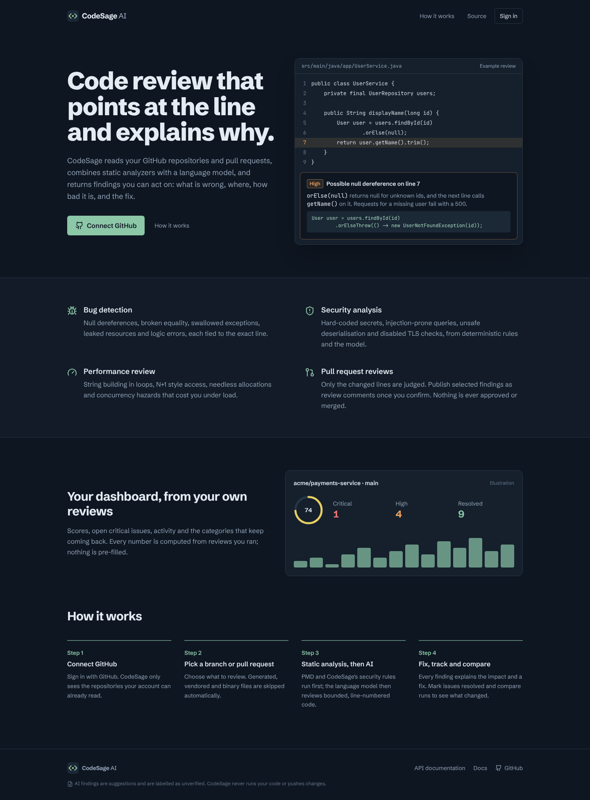 | 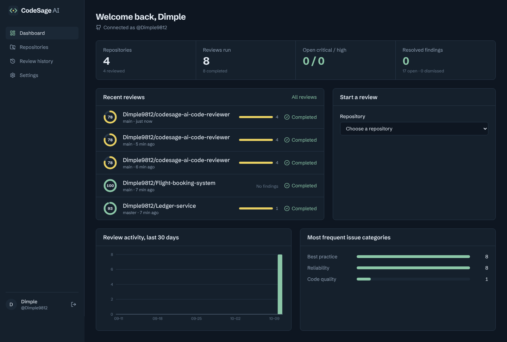 |
| Landing page | Dashboard built from real review data |
| 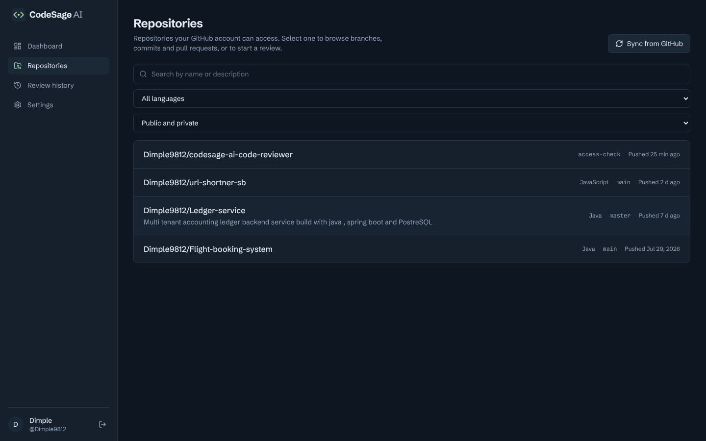 | 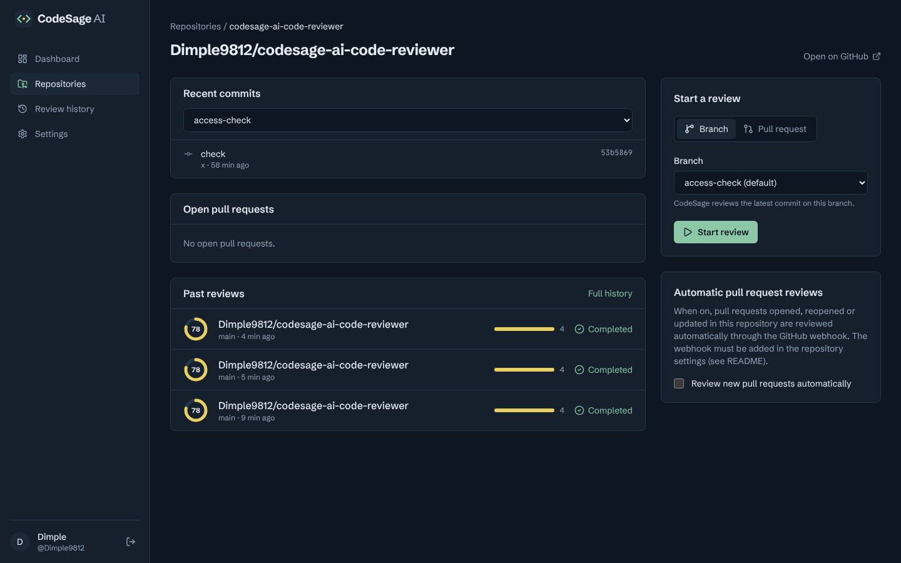 |
| Repository browser | Repository details: commits, PRs, start a review |
| 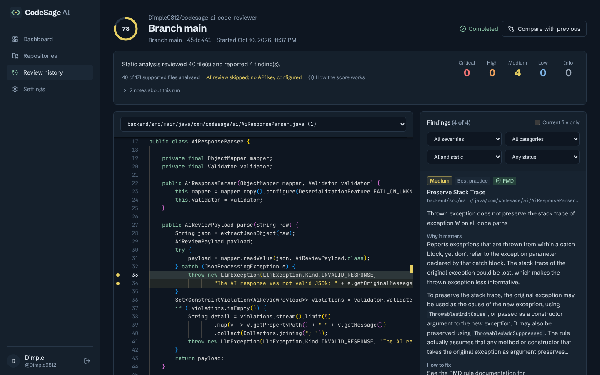 | 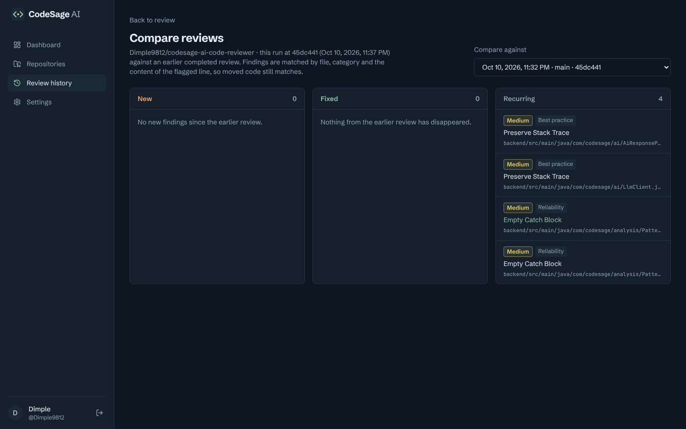 |
| Review workspace (laptop width) | New / fixed / recurring comparison |
| 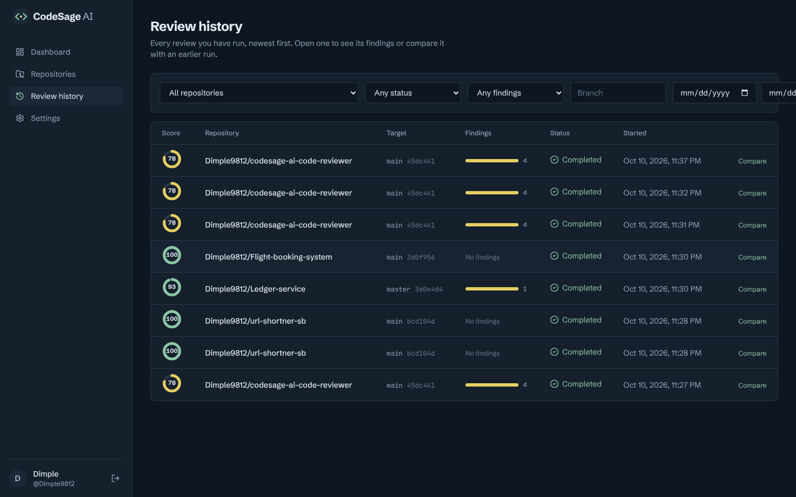 | 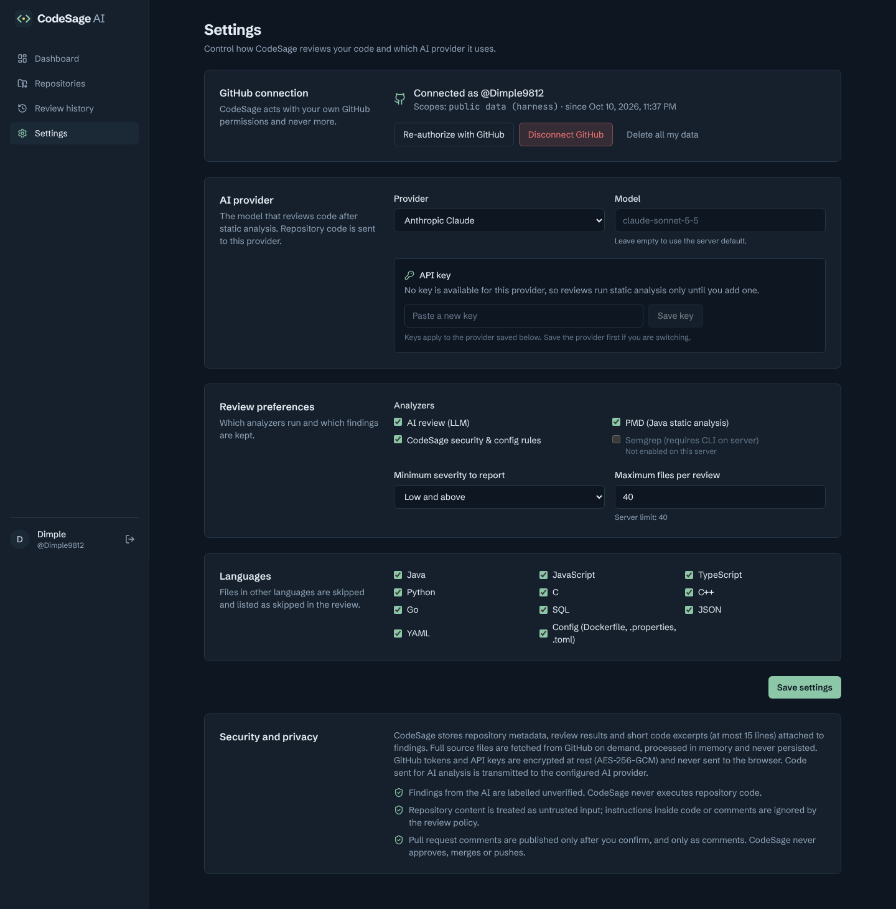 |
| Review history | Settings |

**How they were taken.** The screenshots are from the real application (backend + frontend), run locally on an embedded PostgreSQL with Playwright. No OAuth App was available in that environment, so the session was created by the test-scope [local harness](docs/local-harness.md). The harness is not part of the application jar, it calls GitHub anonymously, and it only works with public repositories. No AI key was configured, so findings come from PMD and the CodeSage rules, and the UI shows "AI review skipped".

## Known limitations

- **The AI path has only been tested against mocked providers.** The provider calls follow the documented Anthropic Messages and OpenAI Chat Completions formats, but no call to a real LLM has been made yet. Results depend on the model and key you configure.
- Docker images and `docker compose up` have not been run end-to-end yet: the build environment could not pull base images. `docker compose config` was validated, and CI builds the images on every push.
- GitHub OAuth Apps can't grant read-only private repository access; `repo` is required. A GitHub App with fine-grained permissions would be stricter (see [Future enhancements](#future-enhancements)).
- Large repositories are reviewed partially, within the configured file, size and request limits. The skipped files and the reasons are listed in each review.
- SpotBugs and Checkstyle are not integrated: SpotBugs needs compiled bytecode, and CodeSage never builds user code. Semgrep needs the CLI on the server.
- Finding fingerprints (used for comparisons) are heuristic. Heavily rewritten lines appear as fixed + new.
- No test suite has been executed against live GitHub or LLM APIs.

## Deployment

Not deployed yet; there is no public URL. To deploy:

1. **Database:** a managed PostgreSQL 16 (private network only). Flyway migrates on startup. For zero-downtime upgrades, run migrations as a separate step with `spring.flyway.enabled=true` on a single instance first.
2. **Backend:** build `backend/Dockerfile` and supply the environment variables from your platform's secret manager (never bake them into images). Set `SESSION_COOKIE_SECURE=true`, `TOKEN_ENCRYPTION_KEY`, `APP_PUBLIC_URL=https://your-domain` and `APP_CORS_ALLOWED_ORIGINS=https://your-domain`.
3. **Frontend:** build `frontend/Dockerfile`. nginx serves the SPA and proxies `/api`, `/oauth2`, `/login/oauth2` to the backend, so everything is same-origin. Put TLS in front (load balancer or platform edge).
4. **GitHub:** update the OAuth App callback to `https://your-domain/login/oauth2/code/github` and the webhook URL to `https://your-domain/api/webhooks/github`.
5. **Redis (multi-instance):** set `CACHE_TYPE=redis` and `RATE_LIMIT_BACKEND=redis`. Keep Redis private.
6. **Health and logging:** use `/actuator/health/readiness` and `/actuator/health/liveness` for probes, and `LOG_FORMAT=ecs` for JSON logs in your log platform. Every response carries `X-Correlation-Id`.

Platform-specific notes (Railway, Render, Fly.io, Kubernetes): [docs/deployment.md](docs/deployment.md).

## Future enhancements

- GitHub App authentication (fine-grained, read-only contents + pull-request write) and installation-level webhooks
- Server-Sent Events for live progress instead of polling
- Sandboxed test execution (isolated containers with no secrets or network, CPU/memory/time limits) to mark findings `CONFIRMED_BY_TEST`
- SpotBugs on CI-built artifacts, ESLint/Bandit/golangci-lint adapters
- One-click "apply suggestion" as a GitHub suggestion block, still behind explicit confirmation
- Team workspaces and organisation-level dashboards

## Contributing

See [CONTRIBUTING.md](CONTRIBUTING.md).

## License

[MIT](LICENSE)
